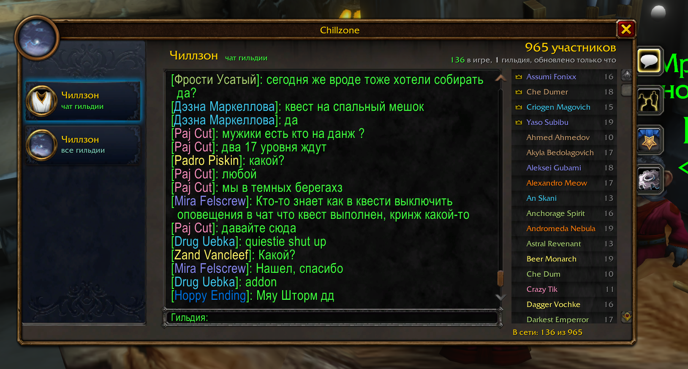
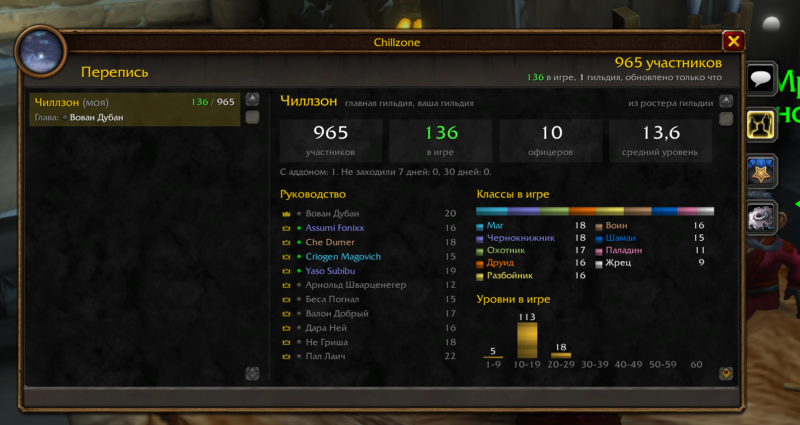
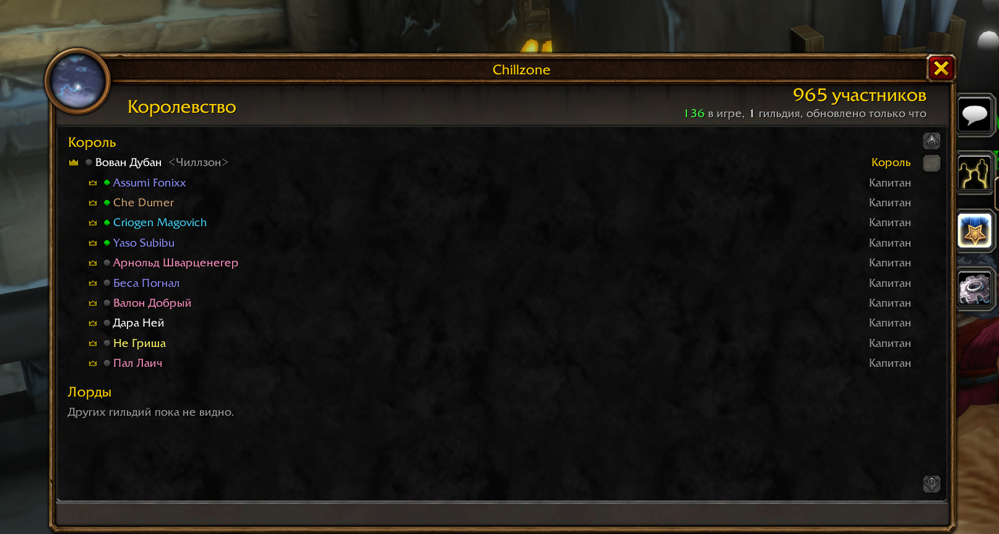
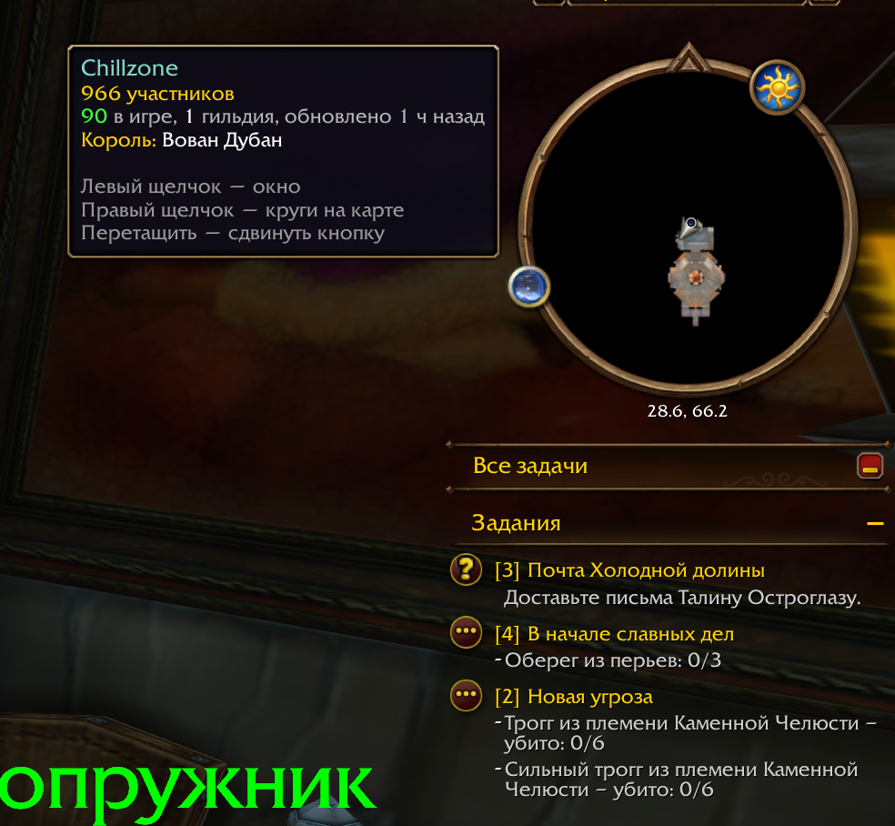

# Chillzone

Аддон для **WoW: Forever**. Связывает все гильдии, в названии которых есть «Чиллзон».

- **Общий чат** на три уровня: все участники, офицеры, главы.
- **Окно** в стиле «Гильдии и сообщества»: каналы, сообщения, люди в сети.
- **Перепись** гильдий: сколько участников, кто в игре, руководство, классы, уровни, зоны.
- **Королевство** и **круги на карте мира**.



<p>


</p>

## Установка

1. Скачайте `Chillzone-<версия>.zip` из [последнего релиза](https://github.com/FiNEk/Chillzone/releases/latest).
2. Распакуйте папку `Chillzone` в `World of Warcraft\_forever_\Interface\AddOns\`.
3. Перезапустите игру и проверьте: `/cz status`.

## Команды

| Команда | Что делает |
|---|---|
| `/cz` | окно Chillzone |
| `/cz1 текст`, `/cz2 текст`, `/cz3 текст` | написать всем / офицерам / главам |
| `/cz help` | все команды |

Кнопка у миникарты открывает окно, а при наведении показывает сводку:



Перепись между гильдиями ходит через ретрансляторов, офицеров главной гильдии. Стартовый список лежит в `RELAYS` в `Chillzone/Config.lua`. Добавить ретранслятора можно командой `/cz relay add Имя Фамилия`.

Как всё устроено, ограничения и чек-лист проверки в игре описаны в [docs/DETAILS.md](docs/DETAILS.md).

## Разработка

```bash
luajit tests/run.lua
```

## Лицензия

MIT, см. [LICENSE](LICENSE). Часть кода портирована из [Olympus](https://github.com/dnl-gentile/olympus-addon) (MIT), подробности в [THIRD_PARTY.md](THIRD_PARTY.md).
